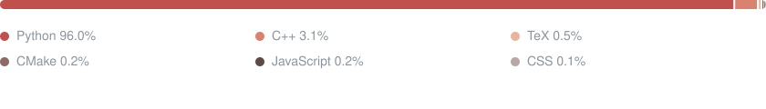
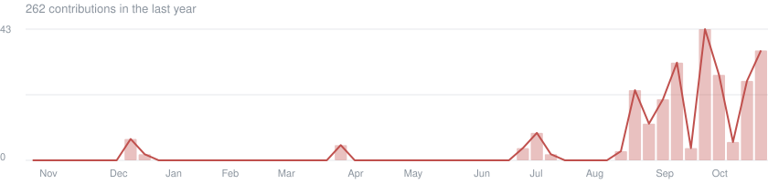

# Abhishek Ravicharan

B.Tech Computer Science & Engineering (AI & ML) · SRM Institute of Science and Technology, Chennai  
[abhishekravicharan@proton.me](mailto:abhishekravicharan@proton.me) · [LinkedIn](https://www.linkedin.com/in/abhishek-ravicharan-003043275/)

## Research

**Q-IDS: Problem-Space Adversarial Robustness of ML Intrusion Detectors**  
*Computers & Security* (Elsevier) · in preparation · [code](https://github.com/shek014/q-ids)

**Machine Learning Approaches to Passenger Survival Prediction**  
IJIREEICE · published · [paper](https://www.researchgate.net/publication/397384830_Machine_Learning_Approaches_to_Passenger_Survival_Prediction_A_Titanic_Dataset_Analysis) · [code](https://github.com/shek014/Spaceship-Titanic-Classification)

## Featured work

**[q-ids](https://github.com/shek014/q-ids)** Python · NumPy · PennyLane · Mininet · Scapy  
Research framework for evaluating the adversarial robustness of classical and quantum ML intrusion detectors against realistic, traffic-level evasion attacks.

**[autonne](https://github.com/shek014/autonne)** C++23 · CMake · GoogleTest  
Open-source C++23 library for truncated SVD and Hermitian eigendecomposition of small complex matrices, validated against LAPACK. Co-maintainer, responsible for code review, CI and releases.

**[Incident Resolution Agent](https://github.com/shek014/Failure-Detection)** LangGraph · FAISS · MCP · FastAPI · Docker  
Multi-agent AIOps platform for automated anomaly detection, root-cause analysis and incident remediation.

**[Real-Time Emotion Recognition](https://github.com/shek014/Real-Time-Emotion-Recognition-System)** YOLO · OpenCV · Flask  
Real-time facial emotion detection from live video using a YOLO-based model.

## Languages

## Activity

